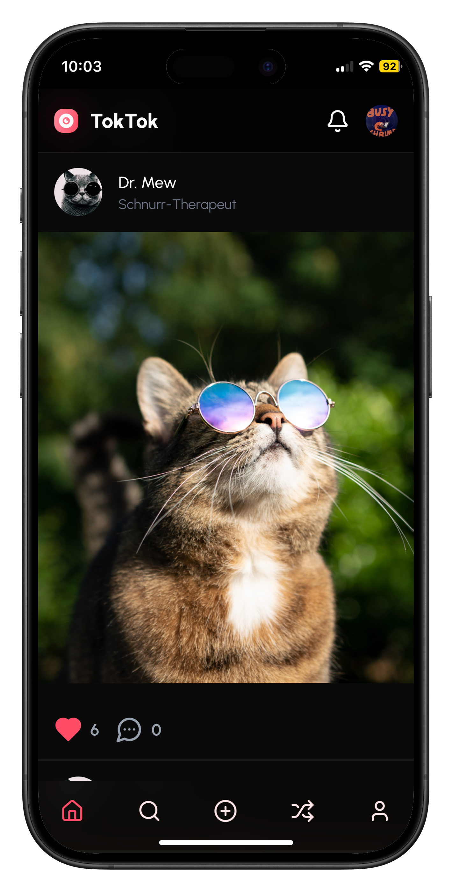
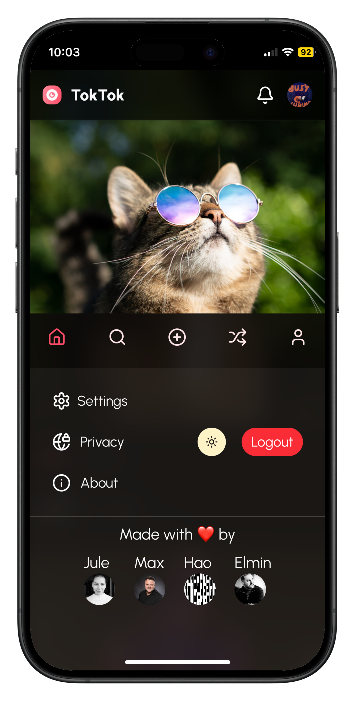

<a id="readme-top"></a>


<div align="center">
  <a href="https://github.com/realmaxv/toktok">
    
  </a>
  
<h1 align="center">TokTok</h3>

  <p align="center">
TokTok ist eine minimalistische Social-Media-App mit reduzierten Funktionen: Posten, liken, kommentieren und sich ohne Algorithmen oder KI-Features auf dem Laufenden halten. Wir wollten einen Ort schaffen, an dem echte Verbindung zählt – nicht die Reichweite eines Beitrags oder die Anzahl der Likes.
    <br />
    <br />
    <br />
    <a href="https://sctoktok.netlify.app/">Zur Live-Demo</a>
    &middot;
    <a href="https://github.com/realmaxv/toktok/issues/new?labels=bug&template=bug-report---.md">Fehler gefunden?</a>
    &middot;
    <a href="https://github.com/realmaxv/toktok/issues/new?labels=enhancement&template=feature-request---.md">Verbesserungsvorschlag?</a>
  </p>
</div>


<details>
  <summary>Inhalt</summary>
  <ol>
    <li><a href="#über-toktok">Über TokTok</a></li>
    <li><a href="#gebaut-mit">Gebaut mit</a></li>
    <li><a href="#installation">Installation</a></li>
    <li><a href="#verbindung-zu-supabase">Verbindung zu Supabase</a></li>
    <li><a href="#team">Team</a></li>
    <li><a href="#lizenz">Lizenz</a></li>
    <li><a href="#credits">Credits</a></li>
  </ol>
</details>


## Über TokTok

<div style="display: flex; justify-content: center; gap: 10px;">


</div>

TokTok ist im Rahmen unseres Abschlussprojekts bei SuperCode entstanden. Unsere Aufgabe war es, eine Instagram-ähnliche Plattform zu entwickeln. Statt eine rein technisches Demoprojekt zu bauen, haben wir ein echtes Produkt für unseren Kurs gecoded. So ist eine kleine App entstanden, mit der wir nach dem Bootcamp in Verbindung bleiben können.

TokTok lädt dazu ein, Inhalte zu teilen, ohne nach Likes zu jagen oder sich mit der ganzen Welt vergleichen zu müssen. Unsere Idee war es, eine persönliche Plattform für den Freundeskreis zu schaffen. Hier gibt es keine Rankings, kein FOMO und keine Werbung. Vielleicht ist TokTok auch eine Inspiration für andere, sich ihre eigene Community-App zu bauen.

Da wir TokTok als Mobile-First-App entwickelt haben, macht die Nutzung auf dem Smartphone am meisten Spaß.

<p align="right">(<a href="#readme-top">Zurück nach oben</a>)</p>


## Gebaut mit


<p align="right">(<a href="#readme-top">Zurück nach oben</a>)</p>


## TokTok ausprobieren

Wenn du einfach nur sehen willst, wie die App funktioniert, besuche die Live-Version hier:

**(https://sctoktok.netlify.app/)**

Du kannst dich mit deiner E-Mail und einem Passwort registrieren.

## Installation

Folgende Schritte zeigen dir, wie du das Projekt lokal starten kannst.

1. **Repository klonen:**

```bash
   git clone https://github.com/realmaxv/toktok.git
```

2. **In das Projektverzeichnis wechseln**:
```bash
cd toktok
```

3. **Abhängigkeiten installieren:**
```bash
npm install
```

4. **Entwicklungsserver starten:**
```bash
npm run dev
```
Die App wird standardmäßig mit [Vite](https://vitejs.dev/) auf  `http://localhost:5173` gestartet.

5. **App im Browser öffnen:**

Rufe im Browser `http://localhost:5173` auf.

6. **Entwicklungsserver stoppen:**

Mit `Strg + C` im Terminal beenden.

<p align="right">(<a href="#readme-top">Zurück nach oben</a>)</p>

## Verbindung zu Supabase

Wenn du dein eigenes [Supabase](https://supabase.com/)-Projekt anbinden möchtest:

1. Lege im Projektverzeichnis eine `.env`-Datei an
2. Trage folgende Variablen ein:

```env
VITE_SUPABASE_URL=https://dein-projekt.supabase.co
VITE_SUPABASE_ANON_KEY=dein-anon-key
```

Diese Daten findest du in deinem Supabase-Dashboard unter "Project Settings" → "API".

## Team

<a href="https://github.com/realmaxv/toktok/graphs/contributors">
  
</a>

<p align="right">(<a href="#readme-top">Zurück nach oben</a>)</p>


## Lizenz

Dieses Projekt steht unter der [MIT-Lizenz](LICENSE).


<p align="right">(<a href="#readme-top">Zurück nach oben</a>)</p>


## Credits

Diese Tools und Ressourcen haben uns beim Bauen von TokTok unterstützt:

* [Shadcn Components](https://ui.shadcn.com/)
* [Lucide Icons](https://lucide.dev/)
* [Mockuphone](https://mockuphone.com)
* [Choose an Open Source License](https://choosealicense.com)

Danke an unseren Kurs und unsere Trainer*innen, die TokTok getestet und uns motiviert haben 👾 

<p align="right">(<a href="#readme-top">Zurück nach oben</a>)</p>


<!-- IMAGES -->
[toktok-mockup1]: src/assets/mockup1.png
[toktok-mockup2]: src/assets/mockup2.png


